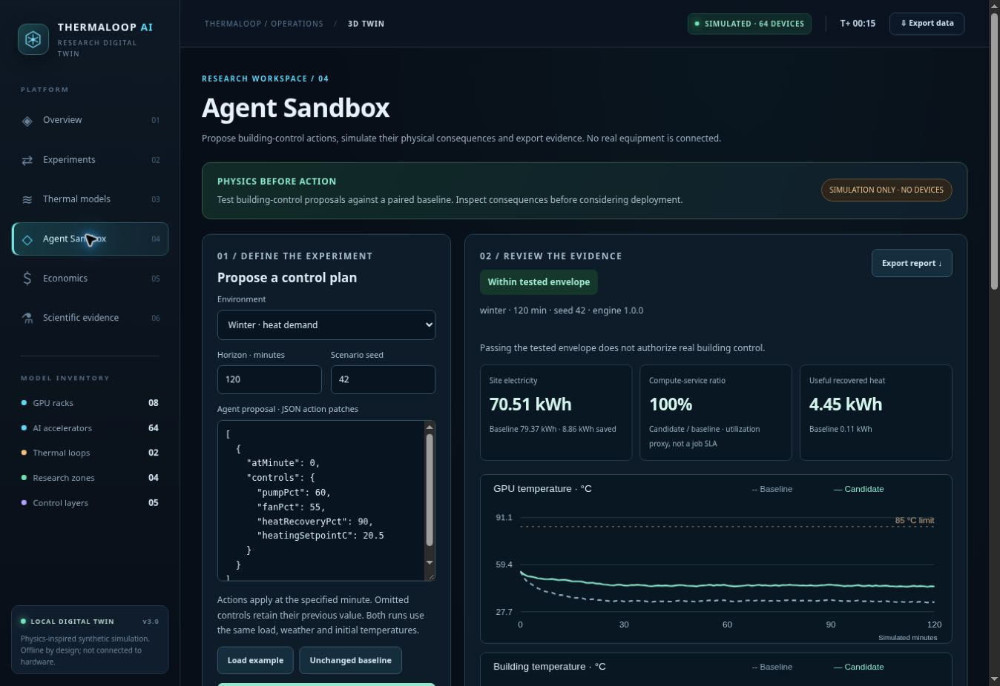

# Agent Sandbox: building-control experiments

ThermaLoop now includes `#agent-sandbox`: a browser-accessible, deterministic environment for an external AI or a person to **propose an action schedule, simulate physical consequences, and inspect evidence before considering deployment**.

It does not contain a trained agent, call an LLM, connect to a building, or authorize hardware commands. Its new three-state plant is separate from the retained 64-GPU campus, published-data experiments and finite-capacity CDU reference. Those workspaces and their engines remain unchanged.



## Use the website

Open `index.html`, choose **Agent Sandbox**, select a scenario, edit the JSON action patches and click **Run physical comparison**. The browser runs the engine in a Web Worker; opening the site directly as a local file uses the same engine on the main thread. No API key or internet connection is needed.

The report compares a baseline with the proposal under identical initial conditions, weather, load, horizon and seed. It includes minute-resolution temperatures/power, the simulated action log, faults, violations, metrics, and two additional sensitivity cases. Export the report to retain the exact inputs and evidence. Editing inputs invalidates the previous report; switching workspaces preserves it.

Controls: GPU power limit, pump speed, dry-cooler fan speed, heat-recovery valve fraction, heating setpoint, ventilation rate and lighting power. The paired comparison uses an open-loop action list. The **Interactive Physics Environment** panel below it also allows a human to start a persistent browser-local episode, observe temperatures, change controls, advance time, and repeat. Its 10-step rule-based feedback demo is not a learned AI or an optimized policy. The exported episode includes its full trajectory and a reproducible control schedule.

**Baseline is not assumed safe.** In hot weather or fault scenarios, both policies may violate limits. Candidate status is absolute against the declared constraints and relative only for compute-service retention. Electricity reduction alone is never a passing criterion.

## Connect an external AI

The original deployment remains a buildless Render Static Site. That host runs browser JavaScript; it does **not** run the optional API server. A public agent cannot POST to the static site's `/api` path and expect simulation execution.

For local agent integration, install Node 22 or newer and run from the repository root:

```sh
node scripts/serve-agent-sandbox.cjs
```

This serves the existing website and API at `http://127.0.0.1:8787`.

| Endpoint | Purpose |
| --- | --- |
| `GET /api/v1/health` | Engine version and explicit disconnected-hardware status |
| `GET /api/v1/schema` | Controls, bounds, defaults and example |
| `GET /api/v1/openapi.json` | OpenAPI 3.1 tool contract |
| `POST /api/v1/simulations/evaluate` | Paired simulation and evidence report |
| `POST /api/v1/episodes` | Create an in-memory episode and receive its initial observation |
| `GET /api/v1/episodes/{id}` | Observe current temperatures, controls, disturbance and accumulated metrics |
| `POST /api/v1/episodes/{id}/step` | Apply optional control changes and advance 1–remaining integer minutes |
| `GET /api/v1/episodes/{id}/report` | Export the trajectory and reproducible replay request |
| `DELETE /api/v1/episodes/{id}` | Discard the in-memory episode |

The static contract is also checked in at `science/agent-sandbox-openapi.json`. Generate it with `node scripts/build_agent_contract.cjs`; verify synchronization with `--check`.

Example request (save as `request.json`):

```json
{
  "schemaVersion": 1,
  "scenario": {"preset": "winter", "seed": 42, "horizonMinutes": 120},
  "plan": [
    {"atMinute": 0, "controls": {"pumpPct": 60, "fanPct": 55, "heatRecoveryPct": 90}},
    {"atMinute": 60, "controls": {"heatingSetpointC": 20.5}}
  ]
}
```

```sh
curl -X POST http://127.0.0.1:8787/api/v1/simulations/evaluate \
  -H 'Content-Type: application/json' --data-binary @request.json
```

Node agents can avoid HTTP:

```js
const sandbox = require('./science/agent-sandbox-model.js');
const result = sandbox.evaluate({scenario: {preset: 'pump-fault'}, plan: []});
console.log(result.verdict, result.candidate.violations);
```

In the web page, the same interface is `ThermaAgentSandbox.evaluate(request)`.

### Closed-loop agent interaction

An external controller no longer needs to predict an entire schedule upfront. Start an episode, read the initial state, choose controls, and step the same plant forward. A new observation includes simulated temperatures, current controls, prescribed weather/load, latest site power/heat recovery, accumulated metrics, violations and the numerical energy residual. Actions are simulated only; there is no device-control endpoint.

```sh
curl -X POST http://127.0.0.1:8787/api/v1/episodes \
  -H 'Content-Type: application/json' \
  -d '{"scenario":{"preset":"winter","seed":42,"horizonMinutes":60}}'

# Replace {id} with the episodeId returned above:
curl -X POST http://127.0.0.1:8787/api/v1/episodes/{id}/step \
  -H 'Content-Type: application/json' \
  -d '{"expectedMinute":0,"minutes":5,"controls":{"pumpPct":85,"fanPct":80}}'

curl http://127.0.0.1:8787/api/v1/episodes/{id}/report
```

Embedded JavaScript controllers can call `startEpisode({scenario})`, `observeEpisode(episode)`, `stepEpisode(episode, {minutes,controls})`, and `episodeReport(episode)` in `science/agent-sandbox-model.js`. They are synchronous and deterministic. The engine resumes the physical and energy states from an internal checkpoint, not from a rounded, user-supplied snapshot. A **completed** episode's trace, metrics, faults and violations match a fresh batch evaluation of `episodeReport(episode).replayRequest`. For an in-progress episode, shorten the replay scenario horizon to the reported elapsed minute when comparing prefix traces.

Run `node examples/closed_loop_controller.cjs` for a dependency-free sample controller that reads each observation and chooses the next simulated action. It then evaluates the resulting schedule against the paired baseline and prints violations and the service tradeoff. The rule is illustrative, not an AI model or safety/energy optimizer; an external agent can replace `chooseControls` with its own policy.

The HTTP `step` body must include `expectedMinute` from the latest observation. If another controller has already advanced the session, the server returns **409 Conflict**, preventing a stale action from silently applying at the wrong time. The optional HTTP server retains at most **16 sessions**, expires them after **30 minutes idle**, and loses them on process restart. Each episode is limited to **360 simulated minutes** and **50 effective control changes**. Session IDs are random UUIDs, but do not replace bearer authentication for remote service. The static Render website cannot serve this Node API; agents need a separately hosted, TLS-protected instance. The browser panel keeps its own episode locally, independent of API sessions.

Paired evaluation requests are stateless and bounded to 360 minutes, 50 scheduled patches and 64 KiB. Offsets must be unique, increasing integers within the horizon. Empty `plan: []` preserves the baseline. Omitting `plan` selects the documented example; callers should send an explicit plan. Omitted controls retain their previous value. Unknown fields, nonfinite values, invalid ranges and invalid ordering are rejected, not silently clipped.

An integration should inspect `verdict.constraintsPassed`, `verdict.serviceMaintained`, all violations and model limitations. `hardwareAuthorized` is always `false`. There is deliberately no endpoint for applying a result to hardware.

For remote agents, host this Node service separately behind TLS. Non-loopback binding requires `THERMALOOP_API_TOKEN`; callers send it as a Bearer token. Do not place the token in the website or a committed file. Cross-origin browser calls are refused. The server bounds concurrent workers and execution time, but is a research/local integration server: production multi-user quotas, persistent experiment storage, audit retention and building-specific authorization are not implemented.

## Physical model and units

`science/agent-sandbox-model.js` is the authoritative shared implementation. All model coefficients are **synthetic assumptions**, not measurements or calibrated building/GPU specifications.

Three lumped states use temperature in °C, heat rates in kW and capacitance in kJ/K:

```text
C_gpu dT_gpu/dt = P_gpu - Q_gpu_to_loop
C_loop dT_loop/dt = Q_gpu_to_loop + P_server + P_pump - Q_recovered - Q_rejected
C_building dT_building/dt = Q_recovered + Q_backup + P_lighting
                         + Q_people + Q_solar - Q_envelope - Q_ventilation - Q_cooling
```

The GPU/loop transfer is a signed conductance times temperature difference. Dry-cooler rejection is positive only when coolant is warmer than ambient. Direct heat recovery requires coolant to exceed room temperature plus an assumed 5 K exchanger approach, is bounded by the transfer conductance, and cannot exceed current heating demand. Negative heat demand does not create recovered heat.

Heating demand is a proportional thermostat with a bounded resistive backup heater. Building cooling uses a separate 25°C proportional setpoint, a capacity bound and fixed COP 3. Envelope loss is `UA * (T_building - T_outside)`. Ventilation uses `rho_air * cp_air * volume * ACH / 3600 * deltaT`, with `rho_air=1.2 kg/m³` and `cp_air=1.005 kJ/(kg K)`. Signed losses become gains when outside air is warmer.

Pump/fan power follows an illustrative cubic command relationship. A prescribed pump fault reduces effective flow without pretending the motor's electrical demand also falls. Lighting and people contribute room heat. GPU heat depends on synthetic load, power limit and thermal throttling. The compute-service metric is integrated served utilization, **not tokens, completed jobs, quality, latency or SLA**.

Site electricity is GPU + server + pump + fan + lighting + resistive backup + room-cooling electricity. Recovered heat is an internal transfer and is never added to electrical savings. The thermal ledger excludes fan heat and cooling-compressor work dissipated outside the three-node boundary. Numerical residual compares stored-energy change against integrated external heat input/removal.

The engine integrates with explicit Euler at 5 seconds and records each minute. Tests compare 5/2-second solutions with a 1-second reference for nominal and pump-fault cases; this checks time discretization, not field accuracy. No temperature clamps hide violations.

## Decision scope

Declared illustrative thresholds: GPU ≤85°C; coolant ≤50°C; occupied building 18–26°C; occupied ventilation ≥0.5 ACH; site electricity ≤100 kW. The result reports the first sampled violation and accumulated sampled duration. It checks the initial thermal state as well as subsequent states.

Two paired sensitivity cases multiply envelope UA by 0.8/1.2 and divide GPU transfer conductance by the same factor. These are limited parameter perturbations of the same model, not confidence intervals, a separately validated plant, or proof against all disturbances.

`within_tested_envelope` requires the candidate to meet constraints in nominal and both perturbed runs, retain at least 99% of the paired compute-service proxy in each case, and pass nominal thermal-ledger checks. It does not require or guarantee energy savings, robustness beyond the horizon, independent model accuracy or real-world safety.

Missing: calibrated site telemetry, multi-zone airflow, humidity/CO₂, CFD, hydraulic pressure/valve curves, heat pumps/storage in this new plant, job queues, hardware control and LLM integration. The new step API enables closed-loop controller experiments but does not itself supply a trained controller, prove optimality or establish field safety. The existing reference studies are retained but do not validate this plant.

## Verification

```sh
node scripts/build_agent_contract.cjs --check
node --test tests/*.test.cjs
```

`tests/agent-sandbox.test.cjs` covers reproducibility, conservation, paired controls, fault propagation, initial-state violations, action timing, input validation, compute-service tradeoffs, numerical refinement and checkpoint/batch parity. `tests/agent-sandbox-api.test.cjs` exercises real loopback HTTP requests, engine parity, token enforcement, content type, request size, read-only serving, episode capacity, step persistence and rejection of hardware endpoints.

`tests/browser_agent_sandbox.py` adds the UI regression suite to the existing pinned Playwright CI: successful/failed runs, stale-result invalidation, exports, workspace preservation and narrow viewport layout.
